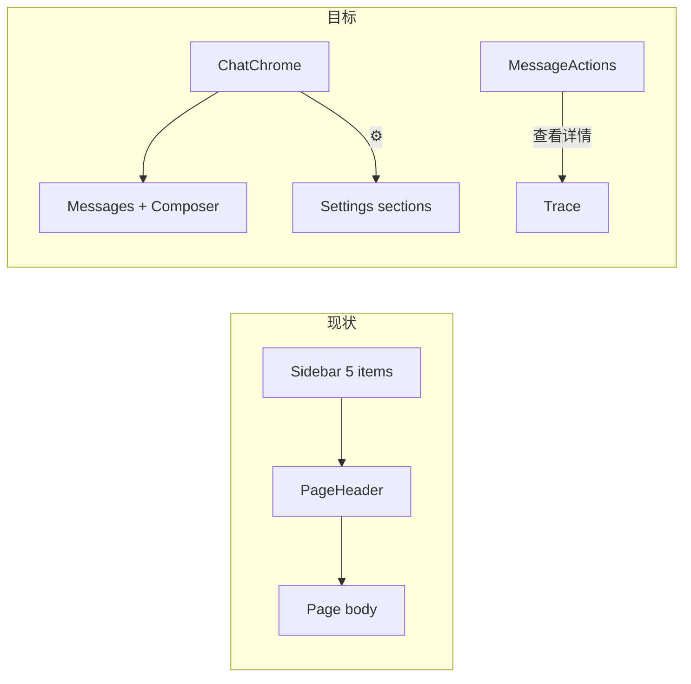
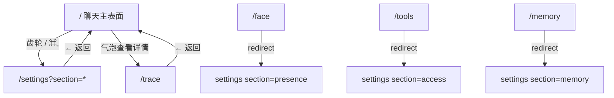

# plan-chat-first-ui v1 — 精简聊天框优先 UI

| 文档信息 | 内容 |
|---|---|
| 版本 | v1 |
| 日期 | 2026-11-24 |
| 状态 | **已被 [v2](../v2/index.md) 取代 UI 形态**（IA「管理进设置」仍有效；未实施） |
| 上游 | `spec-m0b-layout-shell`、现前端 `Sidebar` / `ChatPane` / `settings` / `tools` / `memory` / `face` |
| 定位约束 | AI 优先；能力一份权威；管理面进设置；对话主表面零菜单堆叠 |
| 一句话 | 默认只剩聊天；原侧栏「表情 / 工具 / 记忆」全部收进设置分区；表情保留为对话顶栏存在感 |

---

## 0. 一句话结论

把当前「侧栏五页应用」收敛为 **Chat-first 单表面**：窗口默认只显示会话顶栏 + 消息流 + 输入框；其余管理/只读面板统一进入 **设置（分区导航）**。表情不再占独立页，以顶栏迷你脸承载 poke / 情绪；链路追踪仍从气泡「查看详情」进入，不进主导航。

---

## 1. 背景与目标

### 1.1 现状痛点

| 现状 | 问题 |
|---|---|
| 左侧 92px 常驻 5 项（对话/表情/工具/记忆/设置） | 主任务是聊天，却长期占用一栏「应用菜单」 |
| `/tools` 堆叠 10+ 张管理卡 | 与「AI 优先、UI 是管理面」冲突，工具页像第二块控制台 |
| `/face` 大脸 + 演示按钮 | 日常几乎不需要单独全页；皮肤已在设置 |
| `/memory` 只读总览 | 低频信任面板，不应与对话平级 |
| 页头「标题 + 模型状态」+ 侧栏品牌 | 信息重复；聊天顶栏又有会话药丸 |

### 1.2 目标

1. **默认视口 = 精简聊天框**（会话切换、消息、输入、模型状态、进设置）。
2. **其它菜单进设置**：表情皮肤/演示、工具权限与状态卡、记忆总览、原设置块统一分区。
3. **不削弱能力**：日历授权、感知开关、MCP/Skill、模型、日志等仍可达，只改入口层级。
4. **变更最小化**：优先搬迁组装与壳层，不重写卡片内部业务逻辑。

### 1.3 非目标（本期不做）

- 不做全新视觉品牌重绘 / 换主题色板。
- 不把设置做成独立 OS 窗口。
- 不在聊天里内嵌工具卡（避免对话面再次膨胀）。
- 不改 Rust IPC / 能力权威实现（仅 L6 导航与布局）。

---

## 2. 信息架构（IA）

### 2.1 路由收敛

| 路由 | 现状 | 目标 |
|---|---|---|
| `/` | 对话 | **唯一主表面**（Chat-first） |
| `/settings` | 设置长页 | **二级表面**：分区导航 + 内容 |
| `/settings#…` 或 `?section=` | 无 | 深链到分区（从旧页 redirect） |
| `/face` | 表情全页 | **301/客户端 redirect → 设置·形象** |
| `/tools` | 工具控制台 | **redirect → 设置·权限与工具**（或拆分锚点） |
| `/memory` | 记忆总览 | **redirect → 设置·记忆** |
| `/trace` | 生成链路 | 保留；仅气泡入口；无主导航项 |

### 2.2 设置分区（推荐结构）

设置内用左侧窄分区列表（或顶部分段），右侧滚动态内容。分区顺序按「人 → 模型 → 能力 → 系统」：

| ID | 分区名 | 迁入内容（现有组件复用） |
|---|---|---|
| `presence` | 形象 | `FaceSkinCard`；可选：小幅 poke 预览；`PreviewPane` 演示按钮降级到本区底部或「运维」 |
| `model` | 模型 | `ModelSection`（本地/云端不变） |
| `agent` | 能力 | `McpSection` + `SkillSection` |
| `access` | 权限与工具 | `CalendarCard` / `FileCard` / `WebCard` / `PerceptionCard` / `BoundaryCard`；`PlanProgressCard`（进行中任务） |
| `persona` | 人格与关系 | `PersonaCard` / `ProfileCard` / `RelationshipCard` |
| `memory` | 记忆 | `MemoryOverview`；整理记忆 / 日报周报等维护动作从 `ActionRow` 迁入本区或独立「维护」小节 |
| `ops` | 运维 | `LoopsCard` / `DiagnosticsCard` / `LogsCard` / `ToolCallRecords`；表情瞬态演示可放此 |

> **ActionRow 裁决建议**：日报 / 周报 / 整理记忆 / 主动说一句 属于低频维护，**进设置·记忆或运维**；聊天空态 chips 可保留 1–2 个对话 starter，不再放整排工具按钮。产品若坚持「主动说一句」要快触达，可放会话顶栏溢出菜单（⋯），默认推荐进设置以免聊天顶栏变肥。

### 2.3 聊天表面保留什么

| 元素 | 去留 | 说明 |
|---|---|---|
| 消息流 + Composer | 留 | 核心 |
| SessionDrawer + 会话药丸 | 留 | 对话原生能力 |
| 模型状态点（本地绿/云端黄） | 留 | 从 `PageHeader` 收进聊天顶栏右侧 |
| 迷你脸 + 情绪点 | 留 | 从侧栏迁到顶栏左侧；可 poke |
| 「设置」齿轮 | 新增 | 进 `/settings` |
| 侧栏 5 导航 | **删** | |
| 独立页头「对话」大标题 | **删** | 省一行垂直空间 |
| ApprovalCard / Toast / Onboarding | 留 | 仍挂 AppShell |

---

## 3. UI Wireframe

图例：`█` 实心控件 · `░` 次要 · `···` 可滚区域 · `→` 导航。

### 3.1 主表面：精简聊天（默认）

```
┌──────────────────────────────────────────┐
│  [脸] 阿盆·平静    [会话标题 ▾]    🟢本地 · qwen   ⚙  │  ← ChatChrome（单行）
├──────────────────────────────────────────┤
│                                          │
│   ····································   │
│   ·  消息流（内部滚动）                 ·   │
│   ·  user / bot / proactive / cards     ·   │
│   ····································   │
│                              [↓]         │  ← 回到底部（条件显）
├──────────────────────────────────────────┤
│  [ 说点什么…                        ][↑] │  ← Composer
└──────────────────────────────────────────┘
```

空态：

```
┌──────────────────────────────────────────┐
│  [脸] 阿盆·平静    [默认会话]     🟢本地…  ⚙  │
├──────────────────────────────────────────┤
│                                          │
│           还没聊过                       │
│     说句话，或者等它自己开口。             │
│                                          │
│     ( 在忙什么？ )  ( 帮我记一下… )       │
│                                          │
├──────────────────────────────────────────┤
│  [ 说点什么…                        ][↑] │
└──────────────────────────────────────────┘
```

会话抽屉（行为不变，自右滑入）：

```
┌────────────────────┬─────────────────────┐
│  聊天（变暗）       │  会话               │
│                    │  [+ 新会话]         │
│                    │  ················   │
│                    │  · 当前 ···         │
│                    │  · 其它 ···         │
│                    │  ················   │
└────────────────────┴─────────────────────┘
```

### 3.2 设置表面：分区壳

```
┌──────────────────────────────────────────┐
│  ← 返回对话          设置                │  ← SettingsChrome
├──────────┬───────────────────────────────┤
│ 形象     │                               │
│ 模型   ← │  ··· 当前分区内容 ···         │
│ 能力     │  （既有 Card 纵向堆叠）        │
│ 权限与工具│                               │
│ 人格与关系│                               │
│ 记忆     │                               │
│ 运维     │                               │
└──────────┴───────────────────────────────┘
```

窄窗（≤420px）降级：分区改为顶部横向 scroll chips，内容仍全宽：

```
┌──────────────────────────────────────────┐
│  ← 返回              设置                │
├──────────────────────────────────────────┤
│ [形象][模型][能力][权限][人格][记忆][运维]│  ← 横向 chips，当前高亮
├──────────────────────────────────────────┤
│  ············· 分区内容滚动 ···········  │
└──────────────────────────────────────────┘
```

### 3.3 形象分区（替代 /face）

```
│ 形象                                     │
│ ┌─────────────────────────────────────┐ │
│ │  [迷你预览·可 poke]   当前皮肤名     │ │
│ │  情绪：平静 ●                       │ │
│ └─────────────────────────────────────┘ │
│ 皮肤选择网格（FaceSkinCard 原样）         │
│ 自定义槽位上传…                           │
│ — 可选 — 瞬态表情演示（原 PreviewPane）   │
```

### 3.4 权限与工具分区（替代 /tools 主体）

```
│ 权限与工具                               │
│ 日历授权卡 · 文件目录 · Web · 感知 · 边界 │
│ 进行中计划（PlanProgress）                │
```

### 3.5 记忆分区（替代 /memory + 部分 ActionRow）

```
│ 记忆                                     │
│ [整理记忆] [日报] [周报]   ← 维护动作     │
│ MemoryOverview（计数 / 事实 / 事件…）     │
```

### 3.6 Trace（二级，无主导航）

保持现有全页或「返回对话」顶栏；入口仅 `MessageActions`。

```
┌──────────────────────────────────────────┐
│  ← 返回对话          生成链路            │
├──────────────────────────────────────────┤
│  TraceTimeline / steps …                 │
└──────────────────────────────────────────┘
```

### 3.7 布局对比（结构图）



### 3.8 导航流



---

## 4. 交互与壳层细节

### 4.1 AppShell 变化

| 组件 | 变化 |
|---|---|
| `Sidebar` | 从常驻壳移除；品牌/脸逻辑并入 `ChatChrome`（或 `PresenceBadge`） |
| `PageHeader` | 对话页不再渲染；设置/trace 用各自轻量顶栏（返回 + 标题） |
| `.app` Grid | `92px 1fr` → **单列 `1fr`** |
| `useTabShortcuts` | 废弃 ⌘1–⌘5 五页切换；改为：`⌘,` 或 `⌘/` 打开设置；`Esc` 设置内返回对话（若无模态） |
| 窗口尺寸 | 建议默认宽回到偏聊天：约 **400×560**（无侧栏）；设置页可接受同窗滚动。真机尺寸仍在 `tray.rs` |

### 4.2 ChatChrome（新建）

单行 flex：

1. 左：`PokeFace size="sm"` + 名字 + 情绪点（点击脸 = poke，与现侧栏一致）
2. 中：现有 `sess-pill`（可截断）
3. 右：模型状态（复用 `PageHeader` 逻辑抽 `ModelStatus`）+ 设置按钮

垂直高度目标：≈ 44–48px，替代原「侧栏品牌 + 页头」合计占用。

### 4.3 设置深链

- URL：`/settings?section=memory`（优先 query，利于静态导出与测试）
- 旧路由：`/face` → `section=presence`；`/tools` → `section=access`；`/memory` → `section=memory`
- 内部：`SettingsNav` 高亮 + `scrollIntoView` 或条件挂载当前 section（推荐 **只挂载当前分区** 减重；切换时 remount 可接受，因设置页本就每次进页重查）

### 4.4 可访问性（对齐 AGENTS §10）

- 设置齿轮、返回、分区列表键盘可达；当前分区 `aria-current`
- 模型状态失败时仍有可见文案（不 silent）
- 焦点：从设置返回对话后，Composer 自动聚焦（与现进对话页行为一致）

---

## 5. 组件与文件影响（实施地图）

### 5.1 新增

| 路径 | 职责 |
|---|---|
| `components/layout/ChatChrome.tsx` | 对话顶栏 |
| `components/layout/ModelStatus.tsx` | 从 PageHeader 抽出状态点 |
| `components/layout/SettingsChrome.tsx` | 返回 + 标题 |
| `components/settings/SettingsNav.tsx` | 分区列表 / 窄屏 chips |
| `components/settings/SettingsSections.tsx` | 按 section 组装既有卡 |
| `lib/settingsSections.ts` | section id / 标签 / 旧路径映射（纯函数 + 测） |

### 5.2 修改

| 路径 | 改动 |
|---|---|
| `AppShell.tsx` | 去 Sidebar；按路由条件渲染 ChatChrome vs SettingsChrome |
| `globals.css` / `.app` | 单列布局 |
| `settings/page.tsx` | 分区壳 + 组装 |
| `shortcut.ts` / `useTabShortcuts.ts` | 新快捷键语义 |
| `face/page.tsx` `tools/page.tsx` `memory/page.tsx` | thin redirect |
| 测试：`shortcut` / Sidebar 相关 | 改测 ChatChrome 高亮与 section 映射 |

### 5.3 删除或冻结

- 侧栏主导航用途结束；`Sidebar.tsx` 可删或暂留作未引用（优先删并改测）
- `/face` 页体不再作为产品入口（redirect 即可，组件仍被设置复用）

---

## 6. 实施分期

| 里程碑 | 内容 | 验收 |
|---|---|---|
| **M0 壳收敛** | 去侧栏；ChatChrome；单列；设置入口；旧三路由 redirect | 默认打开即聊天；⚙ 进设置；← 回聊天 |
| **M1 设置分区** | SettingsNav + 七分区组装；深链 `?section=` | 从记忆/工具旧 URL 落到正确分区 |
| **M2 动作收纳** | ActionRow 进记忆/运维；聊天空态只留 starter chips | 工具页不再有独立入口 |
| **M3 快捷键与窗口** | 替换 ⌘1–5；可选收窄默认窗宽 | 文档 + 单测；真机扫一遍 |
| **M4 清理** | 删死代码、更新 `spec-m0b` 继承说明、截图基线 | `tsc` / lint / 相关 test 绿 |

建议默认一次落地 **M0+M1**（用户立刻感到「只剩聊天」）；M2–M4 可同 PR 或紧随。

---

## 7. 风险与约束对齐

| 风险 | 处理 |
|---|---|
| 设置变「超级页」难找 | 分区导航 + 深链；运维默认靠后 |
| 表情演示入口变深 | 接受；皮肤选择仍在形象区；poke 仍在聊天顶栏 |
| 主动搭话/预测事件曾 `router.push("/")` | 行为保持；无侧栏后更合理 |
| AGENTS「AI 优先」 | 管理卡进设置符合；不在聊天堆平行 UI |
| 测试债 | `ROUTES` / Sidebar 测重写为 section 映射测；ChatChrome 最小测 |

---

## 8. 待用户裁决（实施前闭合）

| # | 议题 | 推荐默认 |
|---|---|---|
| Q1 | 设置用「同窗全页」还是「右滑抽屉盖住聊天」？ | **同窗全页**（实现简单、与现路由一致；抽屉易挡消息） |
| Q2 | ActionRow（日报/整理/主动说）放哪？ | **设置·记忆**（维护区）；聊天不放 |
| Q3 | 顶栏是否显示「阿盆」文字还是只留脸？ | **脸 + 短名**（品牌锚点，占宽可控） |
| Q4 | 默认窗口宽度？ | **400×560**（无侧栏）；设置可滚 |
| Q5 | 窄屏设置导航形态？ | **宽度 &lt; 440 用顶部 chips**，否则左分区列表 |
| Q6 | `/face` `/tools` `/memory` 保留 redirect 多久？ | **长期保留**（书签/旧文档），页内零内容 |

---

## 9. 成功标准

1. 冷启动进入 `/`，首屏无侧栏、无「表情/工具/记忆」平级入口。
2. 聊天顶栏可完成：poke、会话切换、看模型状态、进设置。
3. 设置内可完成原五页全部管理/只读能力（分区可发现）。
4. 旧 URL 不 404，落到正确设置分区。
5. Trace 仍仅从气泡进入；Approval / Onboarding / Toast 不受损。
6. 前端质量门：相关 `tsc` / lint / 单测通过。

---

## 10. 附录：现状 → 目标对照速查

| 现入口 | 目标入口 |
|---|---|
| 侧栏·对话 | 默认 `/` |
| 侧栏·表情 | 顶栏脸（poke）+ 设置·形象 |
| 侧栏·工具 | 设置·权限与工具 / 人格与关系 |
| 侧栏·记忆 | 设置·记忆 |
| 侧栏·设置 | 顶栏 ⚙ → `/settings` |
| 页头模型状态 | ChatChrome 右侧 |
| 工具页 ActionRow | 设置·记忆（维护） |
| 气泡·查看详情 | `/trace`（不变） |
