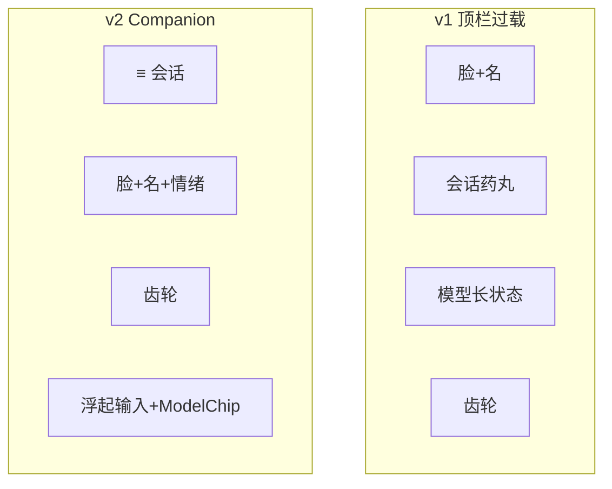
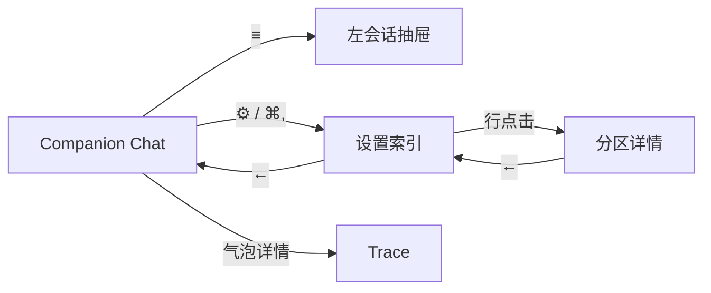

# plan-chat-first-ui v2 — Companion Chat（竞品对标后重设计）

| 文档信息 | 内容 |
|---|---|
| 版本 | **v2**（取代 v1 的 UI 形态裁决；IA「管理进设置」结论继承） |
| 日期 | 2026-11-24 |
| 状态 | **已实施**（Q1–Q7 推荐默认；M0–M3） |
| 前序 | [v1](../v1/index.md)（侧栏拆除 + 设置七分区，顶栏塞满控件） |
| 上游 | 现前端壳层；竞品：ChatGPT/Copilot、BoltAI、SparkAI、Signal AI、Messages、Weeyuga |
| 一句话 | 窄窗 Companion：中间只剩对话；会话从左侧抽屉进；模型嵌在输入条；设置用「索引 → 详情」而非双栏 |

---

## 0. 一句话结论

v1 正确拆掉了「功能侧栏」，但顶栏仍像小仪表盘（脸 + 会话 + 模型 + 齿轮挤一行）。对标同类产品后，阿盆应对齐 **Messages / ChatGPT 窄窗 / BoltAI Companion**：

1. **默认视口只有对话**（存在感头像 + 消息 + 浮起输入条）
2. **会话列表是抽屉，不是常驻导航**（对标 ChatGPT 可折叠 history、BoltAI ⌥⌘S hide sidebar）
3. **模型切换嵌在 Composer 内**（对标 BoltAI message box、SparkAI inline model switcher）
4. **设置是二级「索引列表 → 分区详情」**（对标 iOS/ChatGPT 设置，适配 400 宽；放弃 v1 双栏设置）

管理能力仍全部进设置（继承 v1 IA）；本期仍不重写卡片业务逻辑。

---

## 1. 竞品对标

### 1.1 样本与为何相关

| 产品 | 类型 | 与阿盆相关性 |
|---|---|---|
| **ChatGPT 桌面 / Win Copilot** | 云端对话主产品 | 业界默认 IA：左会话史 + 中线程 + 底输入；插件/设置不进主导航平级 |
| **BoltAI**（Mac 原生 LLM 客户端） | 本地/多模型桌面 | 侧栏=项目/会话；Composer 内嵌模型/工具；设置独立；支持 **Companion 小窗** + 隐藏侧栏 |
| **SparkAI 工作区重设计** | 企业 AI workspace 案例 | 明确反对「模型卡占主区」；收敛到 **input-first**；历史进可折叠侧栏 |
| **Signal AI DESIGN.md** | AI chat 设计系统 | 对话即界面；助手无气泡容器；**浮起 Composer**；强调色只表 live；工具调用默认折叠一行 |
| **macOS Messages** | 系统级会话 UI | 左会话列表（头像+预览）；右转录 + 底输入；身份在对话头，不在功能 Tab |
| **Weeyuga** | 多模型桌面 | 首屏即聊天 + 建议问句；模型在角落轻量切换 |

阿盆差异（设计时保留）：本地优先、人格/表情存在感、托盘小窗、能力走工具而非平行 UI——因此 **不能照搬 BoltAI 三栏大工作区**，应取 **Companion + Messages** 子集。

### 1.2 共性模式（可抄）

| 模式 | 竞品证据 | 对阿盆含义 |
|---|---|---|
| 侧栏只放**会话史**，不放功能 Tab | ChatGPT、BoltAI、Messages、Copilot | 删表情/工具/记忆平级入口（v1 已决） |
| 侧栏**默认可藏**（窄窗几乎必藏） | BoltAI Companion / hide sidebar；ChatGPT 移动端汉堡 | 会话用**左抽屉**，默认关闭 |
| **模型在输入区**，不在顶栏长文案 | BoltAI ⇧⌘M；SparkAI inline switcher | Composer 内 `ModelChip`；顶栏不再写「本地 · qwen…」 |
| **浮起 / 内边距 Composer** | Signal floating card；ChatGPT；iOS Messages capsule | 输入条与左右底留白，不贴边硬切 |
| 空态 = 品牌/角色 + 短提示 + starter | Weeyuga、ChatGPT | 空态中央放大脸 + 一句 copy + chips |
| 设置远离主路径 | 全员 | 齿轮 / ⌘,；窄屏用列表钻取 |
| 高级观测不进主导航 | BoltAI Inspector ⌘I；Signal 折叠 tool row | Trace 仍挂气泡；运维进设置末项 |

### 1.3 反模式（不抄）

| 反模式 | 来源 | 原因 |
|---|---|---|
| 功能图标纵栏常驻 | 阿盆现状 / 部分 agent 控制台 | 把聊天做成「五页 App」 |
| 主区堆模型卡 / 工具卡 | SparkAI legacy；阿盆 `/tools` | 阻断 prompting |
| 宽桌三栏（史+线程+Inspector）常开 | BoltAI 全窗 | 阿盆托盘宽不够 |
| 顶栏塞满状态与切换 | v1 ChatChrome | 窄窗一撞就溢出、焦点散 |

### 1.4 v1 → v2 设计差分

| 项 | v1 | v2 |
|---|---|---|
| 会话入口 | 顶栏药丸 → **右**抽屉 | **左**汉堡 → **左**抽屉（Messages/ChatGPT） |
| 顶栏 | 脸+名+会话+模型状态+⚙ | **汉堡 · 脸+名/情绪 · ⚙**（三槽） |
| 模型 | 顶栏只读状态 | Composer 内可点 `ModelChip`（只读态+进设置·模型） |
| Composer | 贴底通栏 | **浮起圆角条** + 底边距 |
| 空态 | 文案+chips | **大脸居中** + 文案 + chips（存在感即品牌） |
| 设置 | 左分区 + 右内容双栏 | **设置索引列表 → 分区详情**（窄窗友好） |
| 窗宽建议 | 400×560 | **380×560** Companion；会话抽屉打开时内容可被遮罩 |

---

## 2. 信息架构（继承并收紧）

路由收敛与「管理进设置」同 [v1 §2](../v1/index.md)；设置分区 ID 不变，**呈现形态改为钻取**：

```
/                    → Companion Chat（唯一主表面）
/settings            → 设置索引（分组行）
/settings?section=x  → 分区详情（既有 Card）
/face|/tools|/memory → redirect 到对应 section
/trace               → 气泡入口 only
```

设置索引分组文案（对用户）：

| 组 | 行 |
|---|---|
| 我与它 | 形象 · 人格与关系 · 记忆 |
| 智能 | 模型 · 能力（MCP/Skill） |
| 系统 | 权限与工具 · 运维 |

---

## 3. UI Wireframe（v2）

图例：`···` 可滚 · `░` 遮罩 · `⟵⟶` 抽屉方向。

### 3.1 主表面 — Companion Chat（默认，会话抽屉关闭）

```
┌─────────────────────────────────────┐
│  ≡     [脸] 阿盆 · 平静          ⚙  │  ← 顶栏仅 3 槽；无会话标题、无模型长文
├─────────────────────────────────────┤
│                                     │
│         ·· 消息流（居中栏宽） ··     │
│                                     │
│                      user 气泡      │
│         assistant 散文/轻气泡       │
│         ┌ tool 一行折叠 ┐           │  ← 已有工具结果继续折叠呈现
│                                     │
│                                     │
│           ┌───────────────────┐     │
│           │ 说点什么…  qwen ▾ ↑│     │  ← 浮起 Composer；右内 ModelChip
│           └───────────────────┘     │
│              ↑ 左右底 12–16px 边距   │
└─────────────────────────────────────┘
```

### 3.2 空态 — 存在感即首屏品牌

```
┌─────────────────────────────────────┐
│  ≡     [脸] 阿盆 · 平静          ⚙  │
├─────────────────────────────────────┤
│                                     │
│              〔 大脸 〕              │  ← ~96–120px；可 poke
│                                     │
│           还没聊过                  │
│     说句话，或者等它自己开口。        │
│                                     │
│      (在忙什么？)  (帮我记一下)      │
│                                     │
│           ┌───────────────────┐     │
│           │ 说点什么…  qwen ▾ ↑│     │
│           └───────────────────┘     │
└─────────────────────────────────────┘
```

> 对标 Weeyuga / ChatGPT 空态：角色或产品名是视觉锚，不是顶栏小字。阿盆用大脸代替 Logo 字标。

### 3.3 会话抽屉 — 左侧（对标 Messages / ChatGPT）

```
┌──────────────┬──────────────────────┐
│ 会话      +  │░                     │
│ ──────────  │░   （聊天变暗，点遮罩关闭）
│ ● 默认会话   │░                     │
│   昨天·忙什么│░                     │
│ ○ 工作备忘   │░                     │
│   2 小时前   │░                     │
│ ··········  │░                     │
│             │░  ┌───────────────┐   │
│             │░  │ 说点什么…  ↑  │   │
└──────────────┴──┴───────────────┴───┘
     ≈220px ⟶
```

- 打开：顶栏 `≡` / 快捷键 `⌘⇧O`（或沿用现会话快捷若有）
- 行：标题 + 可选最后预览（有则更好，无则只标题——一期可只标题，减范围）
- 新会话 `+`；归档/删除保持现 `SessionDrawer` 菜单逻辑，仅改锚点与滑向
- **不再**用顶栏会话药丸占横向空间

### 3.4 Composer 细部（浮起条）

```
┌──────────────────────────────────────┐
│  说点什么…              │ qwen ▾ │ ↑ │
└──────────────────────────────────────┘
     文本区弹性增长          ModelChip  发送/停
```

| 控件 | 行为 |
|---|---|
| `ModelChip` | 展示短名（`qwen` / 云端条目名）；点击弹出菜单：最近模型 /「管理模型…」→ `/settings?section=model` |
| 发送 / 停 | 同现 Composer；busy 时停钮可用 live 强调色（对标 Signal「橙=live」——沿用现有 accent，不新造色板） |
| 边距 | 容器距左右底 ≥12px；圆角 ≥12px；轻阴影或 1px 描边 |

一期不做 BoltAI 级 Tools/Agent 整排按钮（避免聊天再膨胀）；工具仍 AI 调用 + 设置管理。

### 3.5 设置索引（窄窗钻取）

```
┌─────────────────────────────────────┐
│  ← 对话              设置            │
├─────────────────────────────────────┤
│  我与它                              │
│  形象                          ›    │
│  人格与关系                    ›    │
│  记忆                          ›    │
│                                     │
│  智能                                │
│  模型                          ›    │
│  能力                          ›    │
│                                     │
│  系统                                │
│  权限与工具                    ›    │
│  运维                          ›    │
└─────────────────────────────────────┘
```

### 3.6 设置分区详情

```
┌─────────────────────────────────────┐
│  ← 设置              记忆            │
├─────────────────────────────────────┤
│  [整理记忆] [日报] [周报]            │  ← ActionRow 收纳于此
│  ·· MemoryOverview 卡片 ··          │
└─────────────────────────────────────┘
```

其它分区同 v1 组件清单，仅换壳。

### 3.7 Trace（不变层级）

```
┌─────────────────────────────────────┐
│  ← 对话              生成链路         │
├─────────────────────────────────────┤
│  TraceTimeline …                    │
└─────────────────────────────────────┘
```

### 3.8 结构对比





### 3.9 宽屏可选增强（非本期）

若窗口被用户拉到 ≥720：可把左会话抽屉改为**常驻可折叠栏**（BoltAI 全窗模式）。本期托盘默认走 Companion；预留 `sessionRailMode: 'drawer' | 'docked'` 即可，不必先做。

---

## 4. 交互与壳层

### 4.1 AppShell

| 组件 | v2 行为 |
|---|---|
| `Sidebar`（功能五 Tab） | **删除** |
| `PageHeader` | 对话不用；设置/trace 用轻量 `SecondaryChrome`（← + 标题） |
| `.app` | 单列；无 92px 轨 |
| 对话顶栏 | 新建 `ChatChrome`：`Menu` · `Presence` · `Settings` |
| 会话 | `SessionDrawer` 改为 **左侧**滑入 + 遮罩；触发改 `≡` |
| Composer | 视觉改为浮起条；内嵌 `ModelChip` |
| 快捷键 | `⌘,` 设置；`≡` 对应 `⌘⇧O` 会话；废弃 ⌘1–5 功能页 |

### 4.2 Presence（表情）

- 顶栏 sm 脸：日常情绪 + poke（继承侧栏能力）
- 空态 lg 脸：品牌锚点；poke 同样可用
- 皮肤/演示：仅设置·形象（同 v1）

### 4.3 ModelChip 与权威源

- 展示数据仍读 `llmStore`（单一权威）
- Chip 菜单「管理模型…」进设置；**不在聊天内复制完整 ModelSection**
- 若未就绪：Chip 文案 `连接中…` / `未配置`，失败可见（AGENTS §10）

### 4.4 窗口

- 默认建议 **380×560**（Companion）；真机仍改 `tray.rs`
- 会话抽屉宽 ≈ 220；打开时遮罩聊天，不撑破窗宽

---

## 5. 实施地图（相对 v1 的增量）

### 5.1 新增 / 重定向

| 路径 | 职责 |
|---|---|
| `ChatChrome.tsx` | ≡ · Presence · ⚙ |
| `ModelChip.tsx` | Composer 内短名 + 菜单 |
| `PresenceBadge.tsx` | 脸+名+情绪（顶栏/空态复用尺寸 props） |
| `SettingsIndex.tsx` | 分组行索引 |
| `SecondaryChrome.tsx` | ← + 标题（设置索引/详情/trace） |
| `lib/settingsSections.ts` | section 元数据 + 旧路径映射 + 测 |

### 5.2 修改重点

| 路径 | 改动 |
|---|---|
| `SessionDrawer.tsx` | 右→左；由 Chrome ≡ 打开；可去掉依赖顶栏药丸 |
| `Composer.tsx` | 浮起布局 + 插槽放 ModelChip |
| `ChatPane.tsx` | 空态加大脸；去掉 sess-pill topbar |
| `settings/page.tsx` | 无 section → Index；有 section → 详情 |
| `AppShell` / CSS / shortcuts | 单列壳；新快捷键 |
| `face/tools/memory` pages | redirect |

### 5.3 分期

| 里程碑 | 内容 |
|---|---|
| **M0** | 去功能侧栏；三槽 ChatChrome；浮起 Composer；左会话抽屉；⚙→设置索引 |
| **M1** | 设置索引↔详情；旧路由 redirect；ActionRow 进记忆详情 |
| **M2** | ModelChip 菜单；空态大脸；快捷键；窗宽 |
| **M3** | 清理 Sidebar/PageHeader 对话用法；测与文档 |

---

## 6. 待裁决（v2）

| # | 议题 | 推荐默认 |
|---|---|---|
| Q1 | 会话抽屉方向？ | **左侧**（对标 Messages/ChatGPT；改掉现右侧） |
| Q2 | 设置双栏 vs 索引钻取？ | **索引钻取**（窄窗）；宽屏以后再做双栏 |
| Q3 | ModelChip 一期能否直接切换模型，还是只跳设置？ | **菜单内切换最近已装/已配模型** + 「管理…」；与现 llmStore 切换 API 对齐 |
| Q4 | 空态大脸是否可 poke？ | **可以**（与顶栏一致） |
| Q5 | 默认窗宽？ | **380×560** |
| Q6 | 会话行是否显示最后一条预览？ | **二期**；一期标题足够 |
| Q7 | ActionRow？ | **设置·记忆详情顶部**（同 v1 推荐） |

---

## 7. 成功标准

1. 冷启动首屏：无功能侧栏；顶栏仅 ≡ / 存在感 / ⚙；底部浮起输入。
2. 会话只从 ≡ 左抽屉进入；不占用顶栏中段。
3. 模型短名在输入条内可见；管理入口进设置·模型。
4. 设置先见分组索引，再进详情；旧 `/face` `/tools` `/memory` 深链正确。
5. Trace / Approval / Onboarding / Toast 行为不回归。
6. 相关 `tsc` / lint / 单测通过。

---

## 8. 附录 A — 竞品要点摘录

**BoltAI main window**：[help.boltai.com … main-window](https://help.boltai.com/articles/0500031-the-main-window)  
侧栏=项目/会话；中=聊天；底=message box；Inspector ⌘I；可 Hide sidebar；Companion Window 小窗并行。

**BoltAI message box**：模型/工具/Agent 均在输入条级控件；⇧⌘M 切模型——主线程不离开。

**SparkAI redesign**：[saifkhaan.com/ai_chat](https://www.saifkhaan.com/ai_chat)  
去掉主区模型卡 → unified input；历史结构化侧栏；inline model switcher。

**Signal AI**：对话即 UI；浮起 Composer；live 色克制；tool row 默认折叠；线程限宽。

**Messages**：会话列表与转录分离；身份在对话语境，不在 App 功能 Tab。

## 9. 附录 B — 现状 → v2 入口

| 现入口 | v2 |
|---|---|
| 侧栏·对话 | 默认 Companion |
| 侧栏·表情 | 顶栏/空态脸 + 设置·形象 |
| 侧栏·工具 | 设置·权限与工具 / 人格 |
| 侧栏·记忆 | 设置·记忆 |
| 侧栏·设置 | 顶栏 ⚙ → 索引 |
| 顶栏会话药丸 | ≡ → 左抽屉 |
| 页头模型状态 | Composer `ModelChip` |
| ActionRow | 设置·记忆详情 |
| 气泡·详情 | `/trace` |
